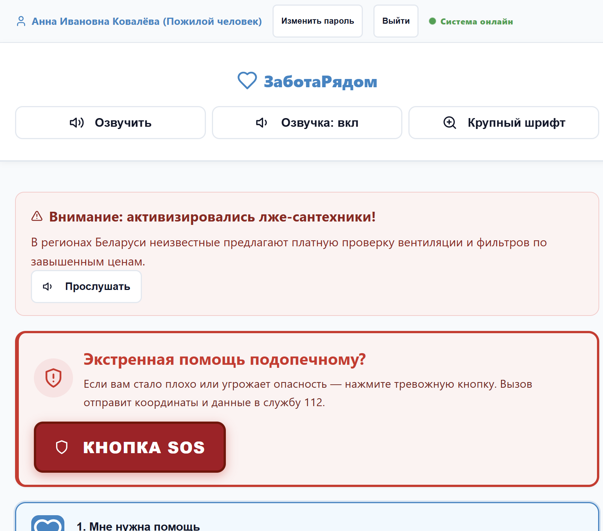
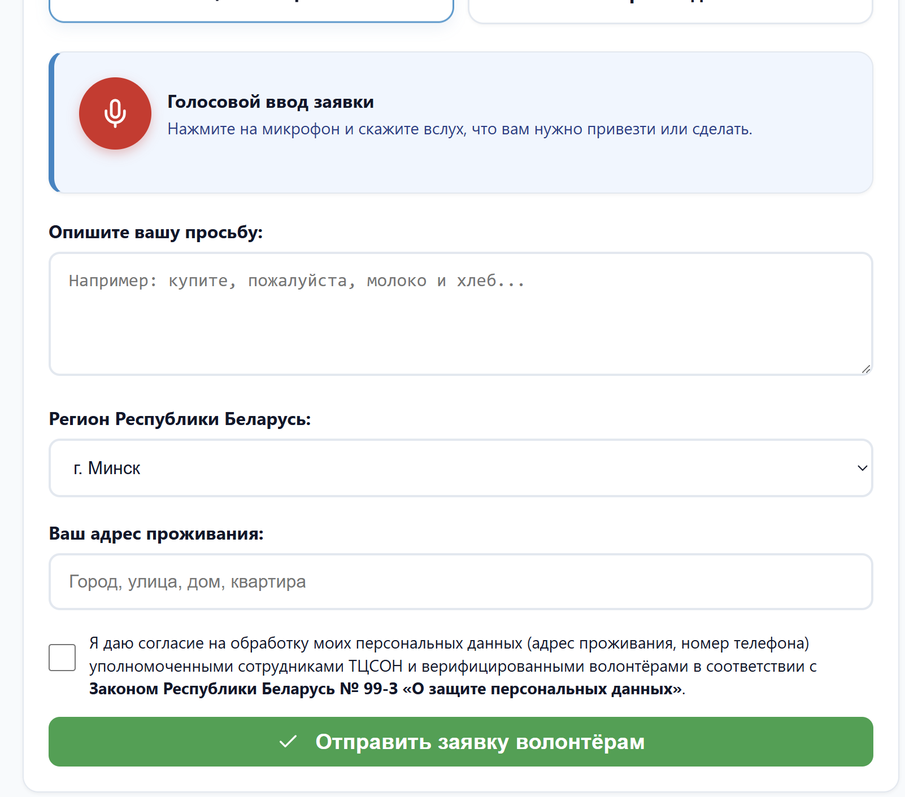
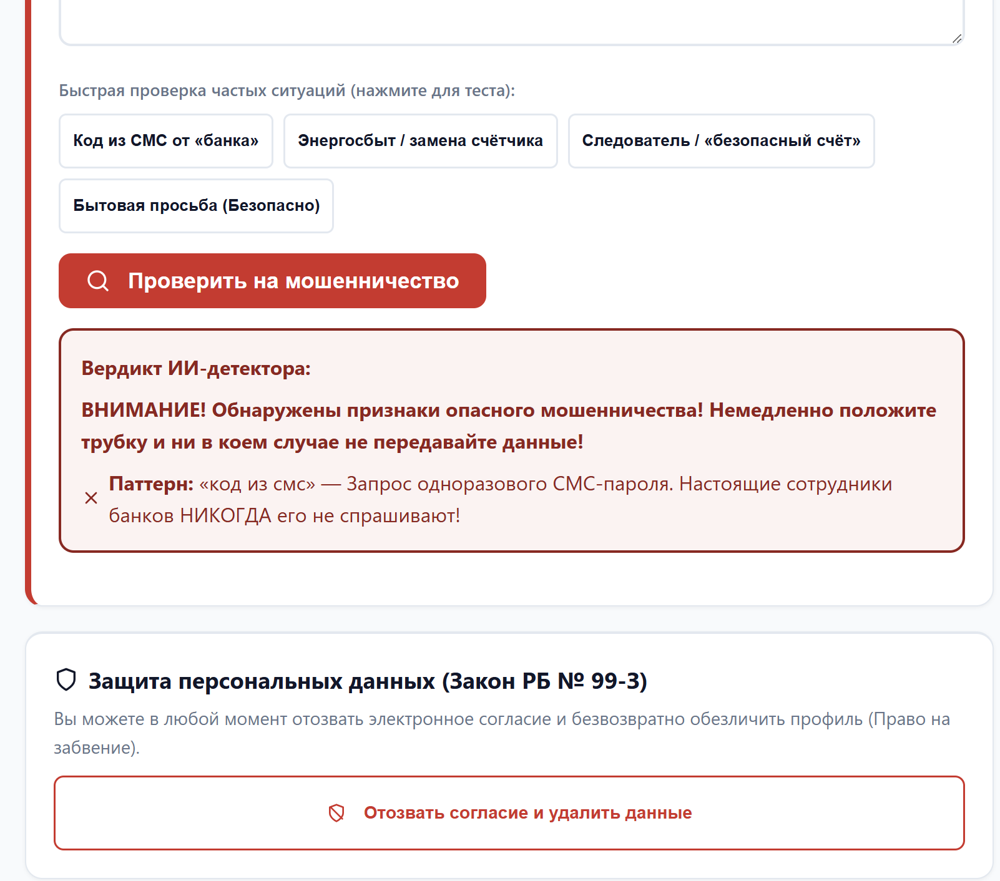
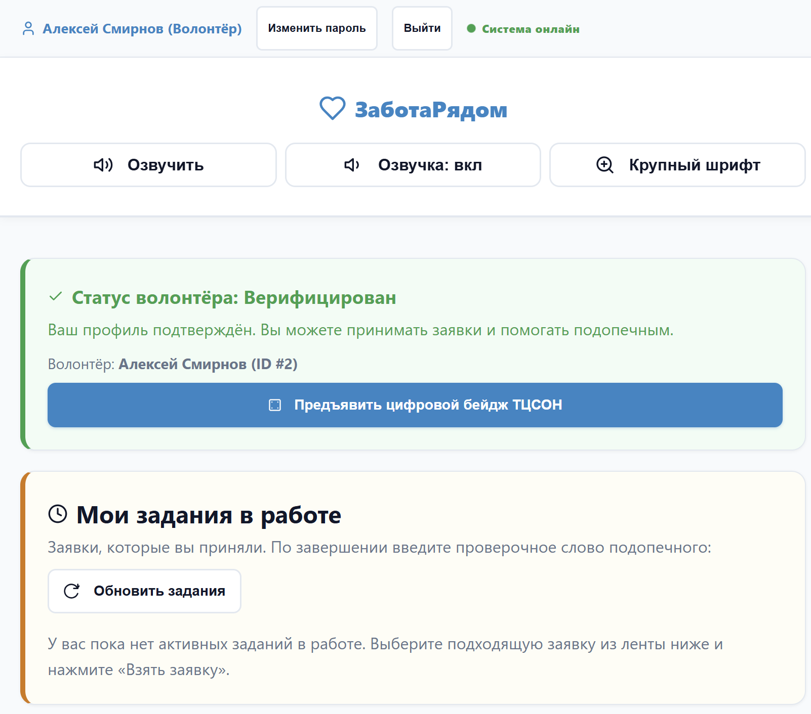
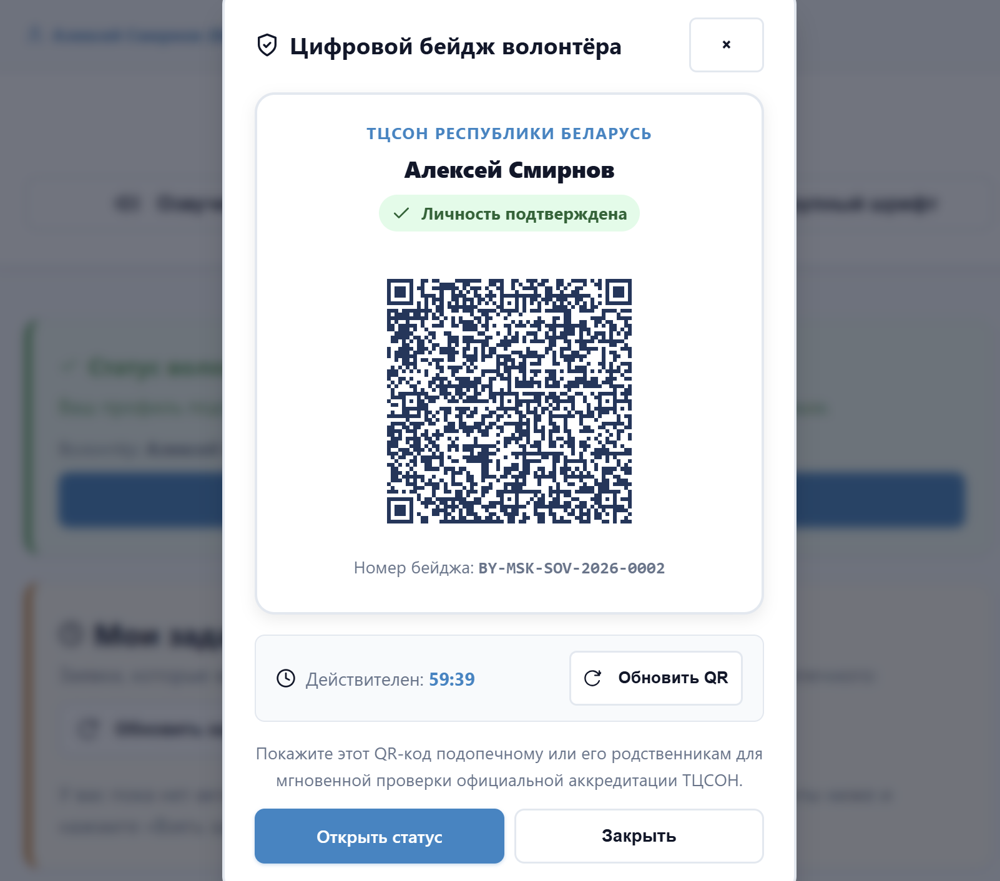
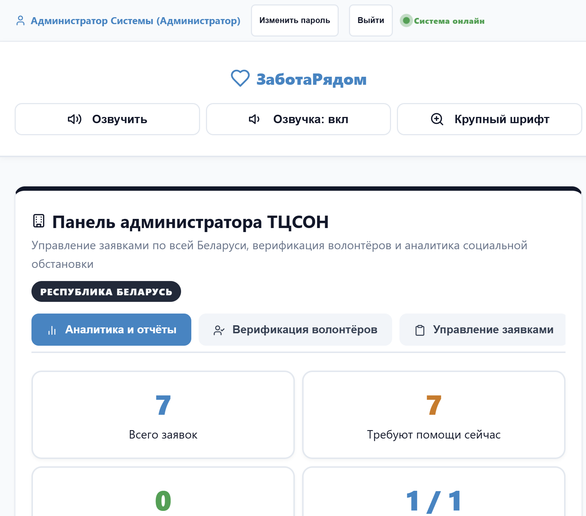

# Senior Care Platform («ЗаботаРядом»)

> Веб-платформа взаимной помощи пожилым людям и волонтёрской поддержки с адаптивным интерфейсом, защитой от мошенников и экстренными вызовами.

[](https://php.net)
[](#)
[](#)
[](#)
[](#)
[](#)

## О проекте

Платформа закрывает основные задачи социальной помощи пожилым гражданам:

- быстрый заказ продуктов, лекарств, бытовой помощи и сопровождения;
- безопасное подтверждение визита волонтёра кодовым словом;
- проверка подозрительных звонков и сообщений на мошенничество;
- верификация волонтёров координатором ТЦСОН;
- экстренный вызов SOS с приоритетом 0;
- адаптивный интерфейс для людей с ослабленным зрением и моторикой;
- аналитика, реестры и экстренные оповещения для координаторов.

## Демонстрация

Скриншоты сделаны на демонстрационных данных.

| Главный экран подопечного | Создание заявки |
|---|---|
|  |  |

| Проверка на мошенничество | Кабинет волонтёра |
|---|---|
|  |  |

| Цифровой бейдж волонтёра | Панель координатора |
|---|---|
|  |  |

## Роли и маршруты

| Роль | Адрес | Вход |
|---|---|---|
| Подопечный | `/` | Гостевой просмотр; для заявок — `/login` |
| Волонтёр | `/volunteer` | `/login`, телефон и пароль |
| Координатор / администратор | `/admin` | `/login`, телефон и пароль |

Сервер определяет роль по HttpOnly-cookie до отдачи HTML и не рендерит разметку чужих ролей. Попытка открыть чужой раздел перенаправляет в собственный. Сотрудники без сессии попадают на `/login`.

На `/` без входа доступен гостевой режим: можно посмотреть функции, проверить подозрительный текст и открыть памятки. Для создания заявки на помощь подопечный входит через `/login` по телефону и паролю.

### Подопечный

- «Мне нужна помощь»: категория, описание, регион, адрес, голосовой ввод, согласие на обработку ПДн.
- «Проверка на мошенничество»: анализ текста, памятки и обучающие материалы.
- Кодовое слово для безопасного визита волонтёра.
- Кнопка SOS и баннер активного вызова.
- Отзыв согласия и право на забвение.

### Волонтёр

- Статус верификации.
- Лента заявок с расстоянием по формуле гаверсинусов.
- Принятие заявки только после верификации.
- Завершение по GPS в радиусе 150 метров и кодовому слову.
- Динамический QR-бейдж с HMAC-подписью и TTL 1 час.
- Баллы, рейтинг и история выполненных задач.

### Координатор / администратор

- KPI-панель и распределение заявок по категориям.
- Верификация и отклонение волонтёров.
- Реестр заявок, смена статусов и отмена.
- Экстренные оповещения для главного экрана подопечных.
- SOS-консоль с приоритетом 0 и сиреной.
- Watchdog просроченных задач и переназначение.
- Выдача одноразовых кодов восстановления пароля.
- Управление категориями и обучающими материалами.

## Аутентификация и безопасность

- Stateless HMAC-SHA256-токены с подписью и TTL.
- HttpOnly-cookie `auth_token`, `SameSite=Lax`, `Secure` при HTTPS.
- Отзыв сессий через `users.token_version`.
- Пароли хранятся через `password_hash()`.
- Rate limiting логина, смены пароля и выдачи кодов.
- RBAC на уровне API и серверного рендеринга.
- Завершение заявки невозможно без кодового слова.
- Геозона 150 метров подтверждает присутствие волонтёра.
- AES-256-GCM защищает медицинские заметки.
- Согласия и обезличивание соответствуют Закону РБ № 99-З.

## Доступность и голос

- Режим крупного шрифта, высокий контраст и таргеты 60px+.
- Учёт `prefers-contrast`, `forced-colors`, `prefers-reduced-motion` и тёмной темы.
- `aria-live`, `aria-label`, видимый `:focus-visible`, навигация с клавиатуры.
- Inline SVG вместо эмодзи.
- Web Speech API: голосовой ввод, озвучивание страницы, голосовая команда SOS.
- Web Audio API: сирена для координатора.
- `Alt+S` останавливает речь.

## Стек

| Слой | Решение |
|---|---|
| Backend | PHP 8.2+, `declare(strict_types=1)`, собственное MVC-ядро |
| API | REST, JSON, RBAC, rate limiting |
| Frontend | HTML5, CSS3 custom properties, vanilla JavaScript ES6+ |
| СУБД one-click | MySQL 8 в Docker |
| СУБД unit/CI | SQLite 3 |
| СУБД production | MySQL 8 |
| Доступ к данным | PDO, prepared statements, миграции на чистом PHP |
| Шифрование | AES-256-GCM через OpenSSL |
| Мониторинг | `/api/health`, `/api/metrics`, Prometheus, Grafana, Loki, Promtail |
| Контейнеры | Docker Compose, Caddy, Nginx, PHP-FPM |
| Зависимости | Без Composer, без npm и сборки фронтенда |

## Структура репозитория

```text
app/
  Core/          Router, Database, Model, Logger, RateLimiter, MetricsService
  Controllers/   REST-контроллеры
  Models/        PDO-модели домена
  Services/      Auth, Crypto, Privacy, GeoMatching, Badge, Watchdog, адаптеры
public/          front controllers, CSS и JavaScript
database/        schema.sql, schema.mysql.sql, migrate.php, seed.php
docker/          Nginx, PHP, entrypoint-скрипты
monitoring/      Prometheus, Grafana, Loki, Promtail, Caddy
tests/           unit, security, API, WCAG, E2E, adversarial
docs/adr/        Architecture Decision Records
start.bat        запуск в один клик для Windows
start.command    запуск в один клик для macOS
start.sh         запуск для Linux/macOS
```

## Архитектурные решения

Полный реестр — в [`docs/adr/README.md`](docs/adr/README.md).

| ADR | Решение |
|---|---|
| [ADR-0001](docs/adr/0001-php82-custom-mvc.md) | PHP 8.2 и собственное MVC-ядро |
| [ADR-0002](docs/adr/0002-vanilla-js-frontend-wcag.md) | Vanilla JS/CSS и WCAG 2.1 AAA |
| [ADR-0003](docs/adr/0003-database-sqlite-mysql.md) | SQLite для unit/CI, MySQL для one-click и production |
| [ADR-0004](docs/adr/0004-pdo-idempotent-migrations.md) | PDO и идемпотентные миграции |
| [ADR-0005](docs/adr/0005-hmac-auth-and-rate-limiting.md) | HMAC-токены, cookie, `token_version`, RBAC |
| [ADR-0006](docs/adr/0006-zero-composer-custom-libraries.md) | Нулевые Composer-зависимости |
| [ADR-0007](docs/adr/0007-aes256gcm-and-data-masking.md) | AES-256-GCM, маскирование, согласия, право на забвение |
| [ADR-0008](docs/adr/0008-identity-provider-adapters.md) | Адаптеры МСИ РБ и ЕСИА |
| [ADR-0009](docs/adr/0009-emergency-112-adapter.md) | МЧС 112 и очередь SOS |
| [ADR-0010](docs/adr/0010-observability-stack.md) | Prometheus, Grafana, Loki, Promtail |
| [ADR-0011](docs/adr/0011-docker-caddy-nginx-phpfpm.md) | One-click MySQL и production-контейнеры |
| [ADR-0012](docs/adr/0012-custom-test-harness.md) | Тест-харнесс, CI и MySQL-smoke |
| [ADR-0013](docs/adr/0013-backups-secrets-healthchecks.md) | Бэкапы, секреты и healthcheck |
| [ADR-0014](docs/adr/0014-web-speech-and-audio-api.md) | Web Speech API и Web Audio API |
| [ADR-0015](docs/adr/0015-anti-fraud-keyword-ai-fallback.md) | Keyword-антифрод и OpenRouter fallback |

## Быстрый запуск

### 1. Один клик: MySQL + приложение

| ОС | Действие |
|---|---|
| Windows | дважды кликните `start.bat` |
| macOS | дважды кликните `start.command` |
| Linux / macOS | `./start.sh` |

Скрипт запускает `docker compose up --build`:

1. MySQL 8 проходит healthcheck.
2. `docker/dev-entrypoint.sh` ждёт БД, применяет миграции и seed.
3. Приложение становится доступно на `http://localhost:8000`.
4. Браузер открывается после ответа `/api/health`.

Остановка — `Ctrl+C`. Другой порт — `start.bat 8001` или `./start.sh 8001`. Без открытия браузера — `START_NO_BROWSER=1`.

Dev MySQL по умолчанию:

```text
database: senior_care
user:     senior
password: senior_dev_password
root:     root_dev_password
```

Переопределяется через `MYSQL_DATABASE`, `MYSQL_USER`, `MYSQL_PASSWORD`, `MYSQL_ROOT_PASSWORD`.
Сброс базы: `docker compose down -v`.

### 2. Локально вручную на SQLite

```bash
php database/migrate.php
php database/seed.php
php -S 127.0.0.1:8000 router.php
```

Откройте `http://localhost:8000`.

Для MySQL вручную задайте `DB_CONNECTION=mysql`, `DB_HOST`, `DB_PORT`, `DB_DATABASE`, `DB_USERNAME`, `DB_PASSWORD`.

### 3. Development Docker

```bash
docker compose up --build
```

Доступно на `http://localhost:8000`. MySQL и приложение запускаются вместе, миграции и seed выполняются автоматически.

### 4. Production Docker

```bash
cp .env.prod.example .env.prod
docker compose --env-file .env.prod -f docker-compose.prod.yml up -d --build
```

| Сервис | Адрес | Назначение |
|---|---|---|
| Caddy | `http://localhost` / `https://домен` | Edge, HTTP/HTTPS |
| Приложение | внутри Docker `app:80` | Подопечные `/`, сотрудники `/login` |
| Grafana | `http://localhost:3000` | Дашборды и логи |
| Prometheus | `http://localhost:9090` | Метрики и алерты |
| Loki | `http://localhost:3100` | Логи |

Production требует `APP_SECRET`, `APP_ENCRYPTION_KEY`, `ADMIN_PHONE`, `ADMIN_PASSWORD`, `METRICS_TOKEN`, пароли MySQL и Grafana. Без них Docker Compose завершится с ошибкой.

`APP_ENCRYPTION_KEY` нельзя менять после начала работы: старые медицинские заметки станут нечитаемыми.

## Переменные окружения

| Переменная | Назначение |
|---|---|
| `APP_ENV` | `local` или `production` |
| `APP_SECRET` | Подпись HMAC-токенов |
| `APP_ENCRYPTION_KEY` | Ключ AES-256-GCM |
| `APP_URL` | Публичный адрес |
| `DB_CONNECTION` | `sqlite` или `mysql` |
| `DB_HOST`, `DB_PORT`, `DB_DATABASE`, `DB_USERNAME`, `DB_PASSWORD` | Подключение к MySQL |
| `OPENROUTER_API_KEY` | Включает AI-антифрод |
| `OPENROUTER_MODEL` | Модель OpenRouter |
| `OPENROUTER_BASE_URL` | Базовый URL OpenRouter |
| `METRICS_TOKEN` | Доступ к `/api/metrics` |
| `SEED_DEMO` | Демо-данные в production |
| `CADDY_DOMAIN` | Домен Caddy |
| `APP_PORT` | Порт приложения в dev |
| `BACKUP_RETENTION_DAYS` | Срок хранения бэкапов |

## API

Основные группы:

- `/api/auth/*` — вход, выход, смена и восстановление пароля.
- `/api/requests*` — заявки, принятие, завершение, отмена.
- `/api/antifraud/*` — проверка текста и активные предупреждения.
- `/api/education*` — памятки и обучающие материалы.
- `/api/chat/*` — сообщения по заявке.
- `/api/coordinator/*` — аналитика, волонтёры, заявки, оповещения, watchdog.
- `/api/sos*` — SOS-вызовы и разрешение инцидентов.
- `/api/volunteers/*` — динамический бейдж и публичная проверка.
- `/api/consent*`, `/api/privacy/*` — согласия и обезличивание.
- `/api/regions`, `/api/categories` — справочники.
- `/api/health`, `/api/metrics` — служебные эндпоинты.

HTTP-тесты используют `http://127.0.0.1:8000`; базовый адрес можно переопределить через `TEST_BASE_URL`.

## Тестирование

Основной набор — **372 проверки**:

```bash
docker compose up -d --build
docker exec senior_care_platform php tests/run_tests.php
docker exec senior_care_platform php tests/test_frontend_wcag.php
docker exec senior_care_platform php tests/test_api_requests.php
docker exec senior_care_platform php tests/test_e2e_comprehensive.php
```

| Набор | Проверок |
|---|---|
| Unit / security | 32 |
| WCAG / ADR | 57 |
| REST API | 26 |
| E2E | 257 |

Дополнительные suite:

```bash
php tests/test_badge.php
php tests/test_privacy.php
php tests/test_sos_geofence.php
php tests/stress_m1_crypto.php
php tests/test_adversarial_m5_suite.php
php tests/test_challenger_m5_stress.php
node tests/test_adr_and_emoji.js
node tests/test_v8_regex.js
```

Тесты меняют БД и rate-limit. Для повторного чистого прогона используйте `docker compose down -v` и снова поднимите стек.

CI `.github/workflows/ci.yml` выполняет линтинг, основной набор тестов, Node-проверки ADR/emoji и regex, production Docker build/healthcheck и MySQL-smoke.

## Тестовые аккаунты

Только для локальной среды:

| Роль | Телефон | Пароль |
|---|---|---|
| Подопечная | `+375291112233` | `password123` |
| Волонтёр | `+375292223344` | `password123` |
| Координатор | `+375295556677` | `password123` |
| Администратор | `+375299999999` | `password123` |

В production демо-аккаунты не создаются. Администратор задаётся через `ADMIN_PHONE` и `ADMIN_PASSWORD`.

## География

Платформа работает по всей Беларуси:

| Код | Регион |
|---|---|
| `MINSK_CITY` | г. Минск |
| `MINSK_OBLAST` | Минская область |
| `BREST` | Брестская область |
| `VITEBSK` | Витебская область |
| `GOMEL` | Гомельская область |
| `GRODNO` | Гродненская область |
| `MOGILEV` | Могилёвская область |

Регион хранится в `help_requests.region_code`, `elderly_profiles.region_code` и `volunteer_profiles.region_code`. Заявка без координат использует центр выбранного региона. Обезличивание также загрубляет координаты до центра региона.

## Мониторинг и эксплуатация

- `/api/health` проверяет БД, storage, AES roundtrip и HMAC-токен.
- `/api/metrics` отдаёт метрики Prometheus и защищён `METRICS_TOKEN`.
- Grafana автоматически получает datasources и дашборд.
- Prometheus-правила: приложение недоступно, БД недоступна, рост 5xx, активный SOS, MySQL недоступен.
- `backup` делает `mysqldump` при старте и каждые 24 часа, хранит 7 дней.
- Восстановление: скопировать дамп из контейнера `senior_care_backup`, распаковать и загрузить в MySQL.
- Grafana, Prometheus и Loki опубликованы только на `127.0.0.1`.

## Лицензия и назначение

Проект предназначен для демонстрации социальной платформы и учебных/пилотных сценариев. Государственные интеграции МСИ, ЕСИА и МЧС 112 реализованы как адаптеры-эмуляторы; для промышленной эксплуатации требуется подключение сертифицированных шлюзов и договоры с операторами.
